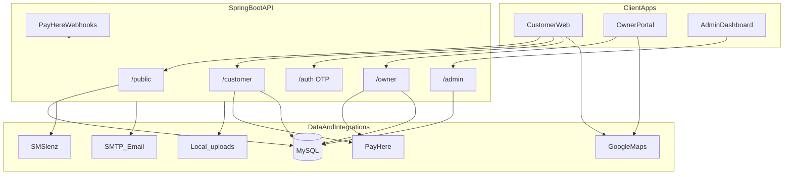

# 01 — System Overview

## Product

**BookNPlay** is a multi-sport venue discovery, court booking, and facility management platform (football, futsal, badminton, tennis, cricket, basketball, swimming, and related sports).

Three product surfaces share one API:

| Portal | Who | Primary jobs |
|--------|-----|--------------|
| Customer web | Players | Discover venues, book slots, pay, manage bookings |
| Business owner portal | Facility operators (+ staff) | Onboard venues, run calendars, pricing, earnings |
| Admin dashboard | Platform operators (`SUPER_ADMIN`) | Businesses, venue status, payouts, homepage CMS, audit |

## High-level architecture



## Communication

- Protocol: HTTPS / REST JSON under `/api/v1`
- Auth: JWT access + refresh tokens; role-scoped routes
- Payments: PayHere sandbox/production checkout + notify webhook
- Maps (browser only): Google Maps JS / Places / Geocoding via Vite env keys

## Repository map

### Frontend (`booknplay-frontend`)

```text
src/
  api/          Axios wrappers per domain (public, customer, owner, admin)
  components/   Layouts, guards, UI, maps, owner dashboard primitives
  hooks/        TanStack Query + auth hooks
  lib/          axios client, Google Maps loader, query client
  pages/        Customer, account, owner, admin pages
  stores/       Zustand auth + favourites
  utils/        Booking intent, payment status, venue helpers
```

### Backend (`booknplay`)

```text
src/main/java/lk/booknplay/
  controller/   public_api, customer, owner, admin, auth, webhook, user
  service/      Business logic (+ impl/)
  repository/   Spring Data JPA
  entity/       Domain model
  security/     JWT filter + token provider
  config/       Security, CORS, app config
  dto/          Request/response payloads
```

## Role model (JWT)

| Role | Frontend area | Backend matcher |
|------|---------------|-----------------|
| `CUSTOMER` | `/`, `/account`, checkout | `/api/v1/customer/**`, `/api/v1/user/phone/**` |
| `BUSINESS_OWNER` / `STAFF` | `/owner/*` | `/api/v1/owner/**` |
| `SUPER_ADMIN` | `/admin/*` | `/api/v1/admin/**` |

Public (no auth): `/api/v1/public/**`, selected auth endpoints, `/api/v1/webhook/**`, Swagger, `/uploads/**`.

## Cross-cutting capabilities

- Venue search and court availability matrix
- Booking hold / quote / cancel / review
- Customer PayHere payment + invoice PDF
- Owner venue onboarding, calendar, walk-in, maintenance, blocked slots
- Owner subscription billing (trial → paid plans)
- Admin payout settlement and homepage publish/versioning
- OTP phone auth (SMSlenz) and email mailer

## Related docs

- Portal feature matrices → [04-portal-features.md](./04-portal-features.md)
- End-to-end flows → [05-customer-owner-flows.md](./05-customer-owner-flows.md)
- API / auth / payments → [06-api-auth-payments.md](./06-api-auth-payments.md)
