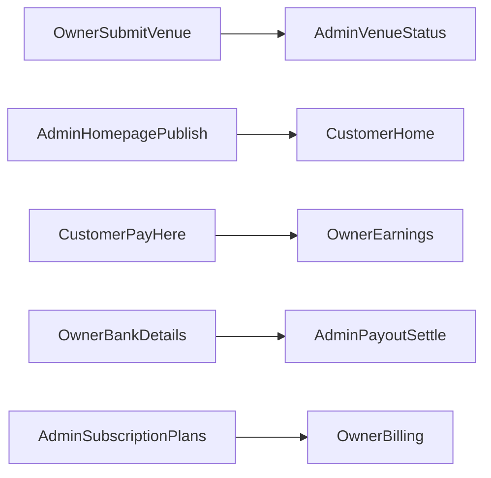

# 04 — Portal Features

Feature matrices for internal tech review. Columns map **UI route** → **frontend surface** → **backend API area**. Status reflects presence in the current codebase (not production readiness of every edge case).

---

## Customer portal

| Feature | Frontend route / page | Backend API area | Notes |
|---------|----------------------|------------------|-------|
| Home discovery & filters | `/` — `HomePage` | `GET /public/homepage`, `/public/venues`, `/public/sports`, `/public/promotions` | Sport / location / date search on home |
| Venue slot selection | `/venues/:venueId/slots` — `ChooseSlotPage` | `GET /public/venues/{id}`, `/public/venues/{id}/courts`, `/public/availability` | Auth not required to browse |
| Quote / pricing preview | Checkout path | `POST /customer/bookings/quote` | Authenticated at checkout |
| Create booking hold | `/checkout` — `CheckoutPage` | `POST /customer/bookings` | Idempotency key supported |
| Payment initiate | Checkout | `POST /customer/payments/initiate/{bookingId}` | Gateway from `VITE_PAYMENT_GATEWAY` (e.g. `PAYHERE`) |
| Payment return | `/payment/return` — `PaymentReturnPage` | Status poll `GET /customer/payments/{bookingId}`; PayHere also hits webhook | Browser return + server notify |
| Booking detail | `/bookings/:bookingId` | `GET /customer/bookings/{id}` | |
| Cancel booking | Booking detail / account | `GET …/cancellation-preview`, `POST …/cancel` | Policy-driven |
| Review booking | Booking detail | `POST /customer/bookings/{id}/review` | |
| Invoice | Booking / payments UI | `GET /customer/payments/invoice/{id}`, `/pdf` | |
| Upcoming bookings | `/account`, `/account/bookings` | `GET /customer/bookings/upcoming` | `ProtectedRoute` |
| Booking history | `/account/history` | `GET /customer/bookings/history` | |
| Favourites | `/account/favourites` | Local `favoritesStore` (+ public venue data) | Client-side store |
| Profile | `/account/profile` | `GET/PUT /customer/profile`, phone OTP link | |
| Privacy / help | `/account/privacy`, `/account/help` | Mostly static / support UI | |
| Email login / register | `/auth/login`, `/auth/register` | `/customer/auth/*` | |
| Phone register / OTP | `/auth/phone-register` | `/auth/otp/*`, `/auth/phone/register` | SMSlenz on backend |
| Forgot password | `/auth/forgot-password` | Customer forgot + `/auth/password/*` | |

**Guard:** `ProtectedRoute` wraps checkout, payment return, booking detail, and account.

---

## Business owner portal

| Feature | Frontend route / page | Backend API area | Notes |
|---------|----------------------|------------------|-------|
| Owner register / login | `/owner/register`, `/owner/login` | `/owner/auth/register`, `/login`, `/refresh`, `/logout`, `/me` | Trial subscription expected on register |
| Forgot password | `/owner/forgot-password` | Owner forgot-password endpoint | |
| Dashboard | `/owner` — `OwnerDashboardPage` | `GET /owner/dashboard/today`, `/owner/activity` | Onboarding checklist in UI |
| Venue list / archive | `/owner/venues` | `GET/DELETE/POST …/venues`, restore | Soft archive + restore |
| Venue onboarding | `/owner/venues/new` | `POST /owner/venues/onboard` (also create) | Multi-step |
| Venue edit | `/owner/venues/:venueId/edit` | `PUT /owner/venues/{id}`, media APIs | |
| Submit for publish | Venue flows | `POST /owner/venues/{id}/submit` | Status workflow with admin |
| Courts per venue | `/owner/venues/:venueId/courts`, `/owner/courts` | `/owner/venues/{id}/courts`, `/owner/courts/{id}` | |
| Operating hours | Venue edit / setup | `GET/PUT …/operating-hours` | |
| Pricing | `/owner/pricing` | `GET/PUT /owner/courts/{id}/pricing` | |
| Booking / cancellation policy | `/owner/venues/:venueId/booking-policy` | `GET /owner/cancellation-policy`, `PUT …/cancellation-policy` | |
| Venue calendar | `/owner/venues/:venueId/calendar`, `/owner/calendar` | `GET /owner/venues/{id}/calendar` | |
| Bookings list | `/owner/bookings` | `GET /owner/bookings`, `/{id}` | |
| Walk-in booking | `/owner/walk-in` | `POST /owner/bookings/walk-in` | |
| Booking status update | Calendar / bookings | `PATCH /owner/bookings/{id}/status` | |
| Availability hub | `/owner/availability` | Calendar + courts APIs | |
| Blocked slots | `/owner/blocked-slots` | `/owner/courts/{id}/blocked-slots` | |
| Maintenance | `/owner/maintenance` | `/owner/courts/{id}/maintenance` | |
| Sports catalog view | `/owner/sports` | `GET /owner/sports` | |
| Promotions | `/owner/promotions` | CRUD `/owner/promotions` | |
| Customers | `/owner/customers` | `GET /owner/customers` | |
| Payments list | `/owner/payments` | `GET /owner/payments` | |
| Refunds | `/owner/refunds` | `GET/POST /owner/refunds` | |
| Earnings & payouts | `/owner/earnings` | `/owner/earnings/*`, `/owner/payouts/*` | |
| Reports | `/owner/reports/*` | Earnings/activity aggregations | Charts (Apex) |
| Team / staff | `/owner/team` | `/owner/staff` | |
| Business settings / bank | `/owner/settings` | `GET/PUT /owner/settings`, business image APIs | Includes payout bank details UX |
| Reviews | `/owner/reviews` | `GET /owner/reviews` | |
| Subscription billing | `/owner/billing`, `/owner/billing/return` | `/owner/subscription`, `/plans`, `/checkout`, payment status | Gated by `VITE_OWNER_SUBSCRIPTIONS` |
| Profile / password | `/owner/profile` | `/owner/auth/me`, `PUT /owner/auth/password` | |
| Business profile media | Settings / business | `/owner/business`, `/images` | |

**Guards:** `OwnerProtectedRoute` + `OwnerLayout`. Roles: `BUSINESS_OWNER`, `STAFF`.

### Owner onboarding checklist (dashboard)

From `OwnerDashboardPage` `ONBOARDING_STEPS`:

1. Add a venue → `/owner/venues/new`
2. Publish a venue → `/owner/venues`
3. Add a court → `/owner/courts`
4. Set operating hours → `/owner/venues`
5. Configure pricing → `/owner/pricing`

---

## Admin portal

| Feature | Frontend route / page | Backend API area | Notes |
|---------|----------------------|------------------|-------|
| Admin login | `/admin/login` | `POST /admin/auth/login` | Role `SUPER_ADMIN` |
| Dashboard | `/admin` | `GET /admin/dashboard` | |
| Homepage CMS | `/admin/homepage` | Draft / publish / versions / restore / slide image | Public homepage reads published config |
| Businesses | `/admin/businesses` | List, access, commission, subscription override, bank verification | |
| Venues status | `/admin/venues` | `GET /admin/venues`, `PATCH …/status` | Approve / suspend style controls |
| Customers | `/admin/customers` | `/admin/customers` CRUD-style admin APIs | |
| Payouts | `/admin/payouts` | Generate, list, status, settle (+ receipt upload), payout config | |
| Subscription plans | `/admin/plans` | `GET/PUT /admin/subscription-plans` | Includes trial plan catalog |
| Audit log | `/admin/audit` | `GET /admin/audit` | |

**Guards:** `AdminProtectedRoute` + `AdminLayout`.

---

## Cross-portal dependencies

