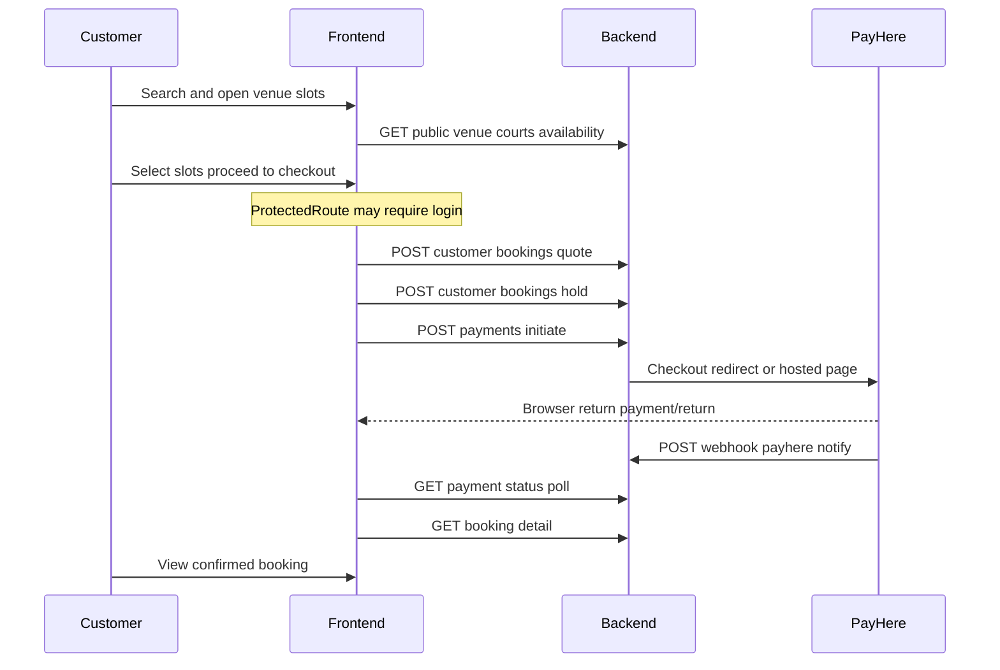
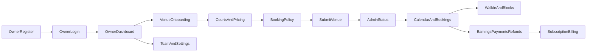
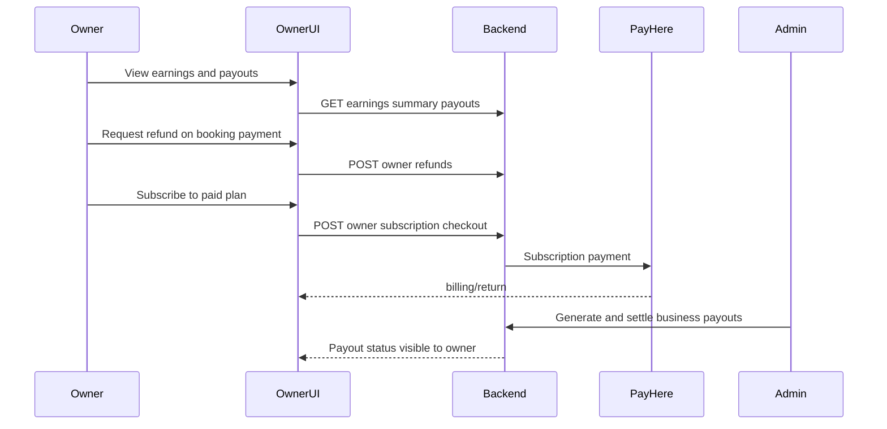
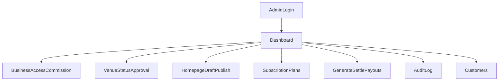

# 05 — Customer & Business Owner Flows

End-to-end flows for technical review. Admin is summarized at the end.

---

## Customer booking flow

### Happy path

1. **Discover** — Customer lands on `/`, filters by sport / location / date, opens a venue.
2. **Slots** — `/venues/:venueId/slots` loads courts + availability for selected dates.
3. **Auth gate** — Checkout requires login (`ProtectedRoute`). Unauthenticated users are sent to `/auth/login` (or register / phone-register).
4. **Quote** — Checkout requests `POST /customer/bookings/quote` for price breakdown (full vs deposit when configured by venue policy).
5. **Hold** — `POST /customer/bookings` creates a held booking (idempotency key from frontend). Hold timer shown in UI.
6. **Pay** — `POST /customer/payments/initiate/{bookingId}?gateway=PAYHERE` returns checkout URL / token.
7. **PayHere** — Browser redirects to PayHere (or hosted checkout HTML under `/public/payhere/checkout/{token}`).
8. **Return** — Browser hits `/payment/return`; frontend polls `GET /customer/payments/{bookingId}`.
9. **Webhook** — PayHere `POST /api/v1/webhook/payhere/notify` confirms payment server-side (source of truth).
10. **Confirm** — Customer views `/bookings/:bookingId`; booking appears under `/account/bookings`.

### Sequence

### Post-booking paths

| Path | Steps | APIs |
|------|-------|------|
| Upcoming | Account → bookings list | `GET /customer/bookings/upcoming` |
| History | Account → history | `GET /customer/bookings/history` |
| Cancel | Detail → preview → confirm | `cancellation-preview`, `POST …/cancel` |
| Review | After completed play | `POST …/review` |
| Invoice | Detail / payments | invoice JSON + PDF |

### Failure / edge cases to review

- Hold expiry before payment completes
- PayHere cancel URL vs success return (both map to `/payment/return` in local config)
- Webhook delayed vs browser return (UI should poll until terminal status)
- Idempotent re-submit of booking create
- Auth token refresh mid-checkout (`axios` interceptor)

---

## Business owner flow

### Lifecycle overview

### 1. Register and enter portal

1. `/owner/register` → `POST /owner/auth/register` (backend should create **TRIAL** subscription).
2. `/owner/login` → tokens stored in `authStore` with role `BUSINESS_OWNER`.
3. Land on `/owner` dashboard (`GET /owner/dashboard/today`).

### 2. Venue onboarding → go live

1. `/owner/venues/new` multi-step onboarding → `POST /owner/venues/onboard`.
2. Add courts → `/owner/venues/:id/courts` or courts hub.
3. Operating hours on venue.
4. Pricing rules → `/owner/pricing`.
5. Booking / cancellation policy → `/owner/venues/:id/booking-policy`.
6. Upload media; submit venue → `POST /owner/venues/{id}/submit`.
7. Admin sets venue status live (`PATCH /admin/venues/{id}/status`).
8. Dashboard onboarding checklist clears as `hasVenue` / `hasLiveVenue` / `hasCourt` / `hasOperatingHours` / `hasPricing` become true.

### 3. Day-to-day operations

| Job | UI | API |
|-----|----|-----|
| See today’s load | Dashboard | `/owner/dashboard/today` |
| Manage day grid | Venue calendar | `/owner/venues/{id}/calendar` |
| List bookings | `/owner/bookings` | `/owner/bookings` |
| Walk-in | `/owner/walk-in` | `POST /owner/bookings/walk-in` |
| Block inventory | `/owner/blocked-slots` | blocked-slots CRUD |
| Maintenance windows | `/owner/maintenance` | maintenance CRUD |
| Update booking status | Calendar / bookings | `PATCH …/status` |

### 4. Money and subscriptions

- Earnings: `/owner/earnings`, payout history under `/owner/payouts*`.
- Customer payment list / refunds: `/owner/payments`, `/owner/refunds`.
- Platform subscription: `/owner/billing` → checkout → `/owner/billing/return` (feature flag `VITE_OWNER_SUBSCRIPTIONS`).
- Bank details on settings feed admin bank verification before settle.

### 5. Org settings

- Team invites: `/owner/team` → `/owner/staff`.
- Promotions: `/owner/promotions`.
- Reviews feed: `/owner/reviews`.
- Business profile + images: `/owner/business`.
- Password / profile: `/owner/profile`.

---

## Admin flow (summary)

Typical ops sequences:

1. **Approve inventory** — Owner submits venue → Admin `/admin/venues` status patch → customer discovery includes venue.
2. **Homepage** — Draft → publish → optional version restore; customers read `GET /public/homepage`.
3. **Payouts** — Configure payout rules → generate → verify bank → settle with transfer reference / receipt.
4. **Subscriptions** — Edit plan catalog; optionally override a business subscription.

---

## Flow ownership matrix

| Flow stage | Customer FE | Owner FE | Admin FE | Backend |
|------------|-------------|----------|----------|---------|
| Discover venues | Yes | — | Homepage CMS | Public APIs |
| Book + pay | Yes | Sees booking | — | Bookings + payments + webhook |
| Operate calendar | — | Yes | — | Owner calendar |
| Go-live gate | — | Submit | Status | Owner + admin venues |
| Money out | — | Earnings view | Settle | Earnings + payouts |
| Platform fee plan | — | Billing | Plans / override | Subscription |
