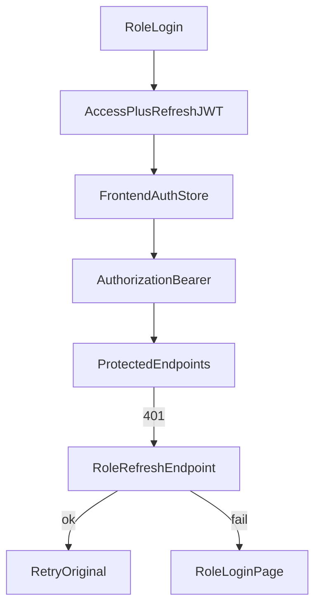

# 06 — API, Auth & Payments

Base URL: `http://localhost:8080/api/v1` (frontend `VITE_API_BASE_URL`).

---

## API surface by role

### Public (`permitAll`)

| Method | Path | Purpose |
|--------|------|---------|
| GET | `/public/homepage` | Published homepage config |
| GET | `/public/businesses` | Business directory |
| GET | `/public/venues` | Search / list venues |
| GET | `/public/venues/{id}` | Venue detail |
| GET | `/public/venues/{id}/courts` | Courts |
| GET | `/public/venues/{id}/reviews` | Reviews |
| GET | `/public/sports` | Sports catalog |
| GET | `/public/promotions` | Public promotions |
| GET | `/public/availability` | Court availability (`courtId`, `date`) |
| GET | `/public/payhere/checkout/{token}` | Hosted checkout HTML |
| GET/POST | `/public/payhere/return`, `/cancel` | Gateway browser callbacks |

### Shared auth OTP (`permitAll`)

| Method | Path |
|--------|------|
| POST | `/auth/otp/request`, `/auth/otp/verify` |
| POST | `/auth/phone/register` |
| POST | `/auth/password/forgot`, `/auth/password/reset` |

### Customer (`ROLE_CUSTOMER`)

| Area | Paths |
|------|-------|
| Auth | `POST /customer/auth/register\|login\|refresh\|logout`, `GET /me` |
| Profile | `GET/PUT /customer/profile` |
| Phone link | `POST /user/phone/request-otp`, `/verify` |
| Bookings | `POST /`, `/quote`; `GET /`, `/upcoming`, `/history`, `/{id}`, `/by-ref/{ref}`; cancel + review |
| Payments | `POST /customer/payments/initiate/{bookingId}`; `GET /{bookingId}`; invoice + PDF |

### Owner (`BUSINESS_OWNER` / `STAFF`)

| Area | Paths (prefix `/owner`) |
|------|-------------------------|
| Auth | `/auth/register\|login\|refresh\|logout\|me`, `PUT /auth/password` |
| Business | `/business`, `/business/images*` |
| Venues | `/venues`, `/venues/onboard`, `/{id}`, submit, media, hours, cancellation-policy |
| Courts | `/venues/{id}/courts`, `/courts/{id}`, `/courts/{id}/pricing` |
| Calendar ops | calendar, walk-in, booking status, maintenance, blocked-slots |
| Portal lists | bookings, payments, refunds, customers, sports, promotions, settings, reviews, activity |
| Dashboard | `/dashboard/today` |
| Earnings | `/earnings/summary`, `/earnings/daily`, `/payouts*` |
| Staff | `/staff` |
| Subscription | `/subscription`, `/plans`, `/checkout`, `/payments/{id}` |

### Admin (`SUPER_ADMIN`)

| Area | Paths (prefix `/admin`) |
|------|-------------------------|
| Auth | `/auth/login\|refresh\|logout\|me` |
| Platform | `/dashboard`, `/businesses*`, `/venues*`, `/subscription-plans`, `/audit` |
| Payouts | `/payouts*`, `/payout-config`, bank verification |
| Homepage | `/homepage` draft/publish/versions/restore, slide image |
| Customers | `/customers` |

### Webhooks (`permitAll`)

| Method | Path | Purpose |
|--------|------|---------|
| POST | `/webhook/payhere/notify` | PayHere payment notify (form-urlencoded) |
| POST | `/webhook/payment/{gateway}` | Generic gateway webhook |

Full interactive catalog: Swagger UI at `/swagger-ui.html` when the API is running.

---

## Authentication model

### Token behaviour

| Setting | Typical local value |
|---------|---------------------|
| Access token TTL | `jwt.access-token-expiry-ms` (e.g. 15 minutes) |
| Refresh token TTL | `jwt.refresh-token-expiry-ms` (e.g. 7 days) |
| Password hash | BCrypt |

### Frontend refresh routing (`src/lib/axios.js`)

| Stored role | Refresh path | Login redirect |
|-------------|--------------|----------------|
| `CUSTOMER` | `/customer/auth/refresh` | `/auth/login` |
| `BUSINESS_OWNER` / `STAFF` | `/owner/auth/refresh` | `/owner/login` |
| `SUPER_ADMIN` | `/admin/auth/refresh` | `/admin/login` |

### Security matchers (backend)

See `SecurityConfig`: public + webhook + selected auth endpoints are `permitAll`; everything else is role-scoped as above. Missing/invalid JWT → **401** (so refresh can run); authenticated wrong role → **403**.

---

## Payments (customer booking)

### Config (names only)

| Key | Side |
|-----|------|
| `VITE_PAYMENT_GATEWAY` | Frontend (e.g. `PAYHERE`) |
| `payhere.merchant-id` / `payhere.merchant-secret` | Backend |
| `payhere.app-id` / `payhere.app-secret` | Backend refund API |
| `payhere.checkout-url` | Sandbox or live PayHere URL |
| `payhere.notify-url` | Publicly reachable webhook (often ngrok in local) |
| `payhere.return-url` / `payhere.cancel-url` | Frontend `/payment/return` |
| `app.base-url` | Backend host for hosted checkout |

Do not put merchant secrets in frontend env files.

### Booking → payment sequence

1. Customer creates booking hold (`POST /customer/bookings`).
2. Frontend initiates payment with gateway query param.
3. Backend creates `Payment` row linked 1:1 to booking, returns redirect / checkout token.
4. PayHere processes card / wallet.
5. **Notify webhook** updates payment + booking state (authoritative).
6. Browser return page polls until UI shows success/failure.
7. Invoice endpoints available once paid.

### Owner subscription payments

Separate flow under `/owner/subscription/checkout` with return at `/owner/billing/return`. Same PayHere integration family; status poll via `/owner/subscription/payments/{paymentId}`.

### Refunds

- Owner-initiated: `POST /owner/refunds` (uses PayHere refund credentials when configured).
- Admin payout settlement is **bank transfer ops**, not the customer card capture path.

---

## Response shape

APIs commonly wrap payloads in an `ApiResponse` envelope. Frontend helpers `unwrapApiData` / module-level `data()` normalize this for hooks and pages.

---

## Review points for engineering

- Confirm notify URL is reachable from PayHere in each environment.
- Confirm return URLs match the deployed frontend origin.
- Exercise refresh for all three roles before release.
- Validate deposit vs full payment against venue cancellation policy.
- Treat webhook as source of truth; UI polling is UX only.
