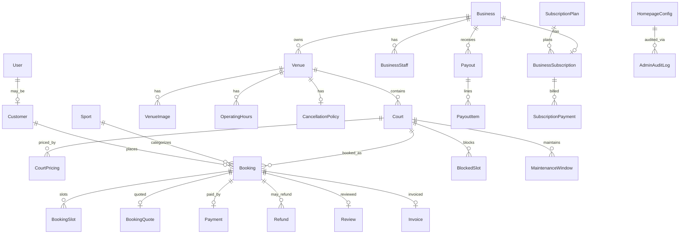

# 07 — Data Model

JPA entities under `lk.booknplay.entity` (MySQL). This is a conceptual map for tech review, not a full ER dump.

## Core domain graph

## Entity inventory

| Entity | Role |
|--------|------|
| `User` | Spring Security `UserDetails`; roles include customer / owner / staff / admin |
| `Customer` | Customer profile linked to user |
| `Business` | Owner organization; images; bank / commission related fields |
| `BusinessImage` | Business media |
| `BusinessStaff` | Staff membership under a business |
| `Venue` | Bookable facility under a business; status drives public visibility |
| `VenueImage` | Venue media |
| `Court` | Bookable unit inside a venue |
| `CourtPricing` | Time/rule-based pricing |
| `Sport` | Sport catalog |
| `OperatingHours` | Venue weekly hours |
| `CancellationPolicy` | Advance / deposit / cancel rules |
| `BlockedSlot` | Owner-blocked inventory |
| `MaintenanceWindow` | Court maintenance periods |
| `Booking` | Reservation aggregate (customer optional for walk-in) |
| `BookingSlot` | Concrete time segments on a booking |
| `BookingQuote` | Quoted pricing snapshot |
| `Payment` | 1:1 with booking for customer payments |
| `Refund` | Refund records against payments/bookings |
| `Invoice` | Invoice metadata for paid bookings |
| `Review` | Customer reviews |
| `Promotion` | Owner/public promotions |
| `RefreshToken` | Persisted refresh tokens |
| `OtpVerification` | Phone OTP challenges |
| `BusinessSubscription` | Trial / paid subscription state per business |
| `SubscriptionPlan` | Plan catalog (incl. trial) |
| `SubscriptionPayment` | Owner plan checkout payments |
| `Payout` / `PayoutItem` | Owner payout batches and line items |
| `PlatformPayoutConfig` | Admin payout rules |
| `HomepageConfig` | Draft/published homepage CMS |
| `AdminAuditLog` | Admin action audit trail |

## Key relationships (code-backed)

| From | To | Notes |
|------|----|-------|
| `Venue.business` | `Business` | Required many-to-one |
| `Booking.court` / `venue` / `sport` | Court, Venue, Sport | Required |
| `Booking.customer` | `Customer` | Nullable (walk-in) |
| `Payment.booking` | `Booking` | Unique join — one payment row per booking |
| `Business` → venues | `OneToMany` | Cascade managed in entity |

## Status / workflow concepts

Exact enum names live in `lk.booknplay.enums`. Conceptually review these workflows:

| Domain | Typical states to validate in code |
|--------|-------------------------------------|
| Venue | Draft / submitted / live / archived (see frontend `venueStatus` helpers) |
| Booking | Hold → confirmed / cancelled / completed (plus owner status patches) |
| Payment | Initiated → success / failed / pending (polled + webhook) |
| Subscription | Trial → active paid / expired (admin can override) |
| Payout | Generated → verified → settled |

## Storage notes

- Relational data: MySQL (`spring.datasource.url=jdbc:mysql://…/booknplay`).
- Media: multipart uploads served under `/uploads/**` (local filesystem in current setup).
- Hibernate `ddl-auto=update` is used in local properties — production should use migrations (gap to track in ops).

## Related docs

- Portal features → [04-portal-features.md](./04-portal-features.md)
- Payment & auth contracts → [06-api-auth-payments.md](./06-api-auth-payments.md)
